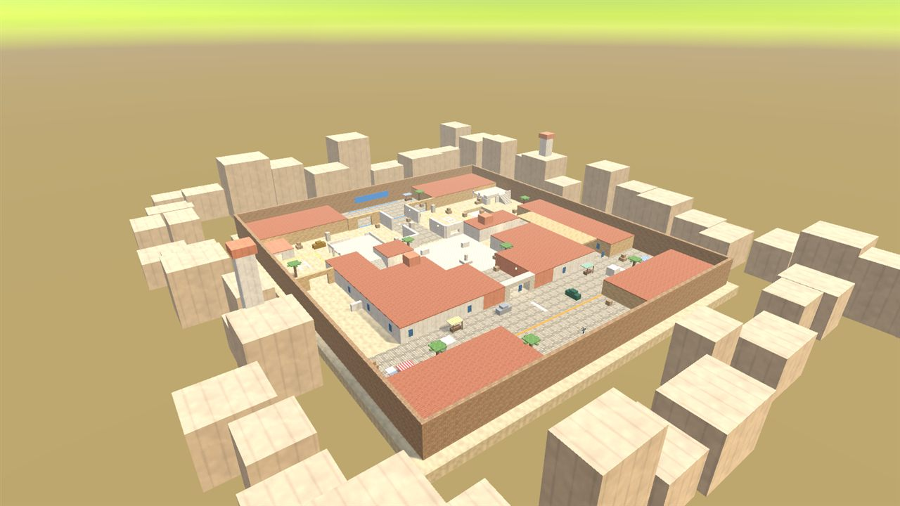
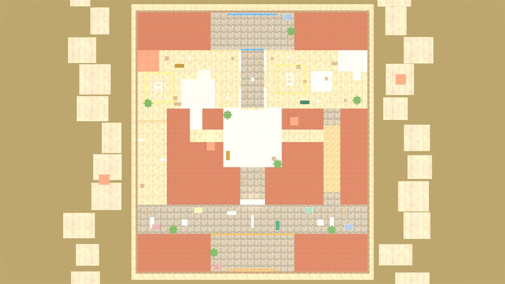
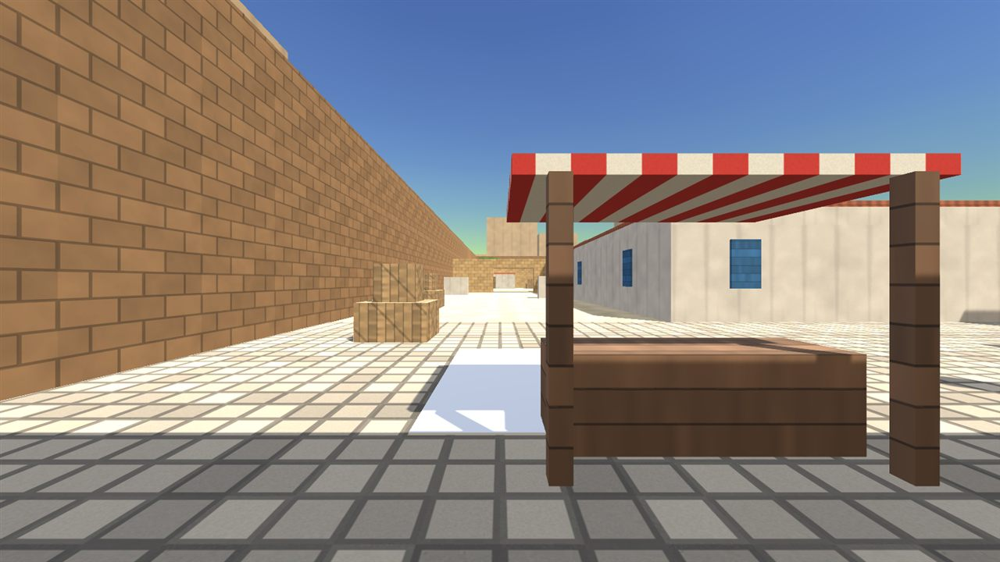
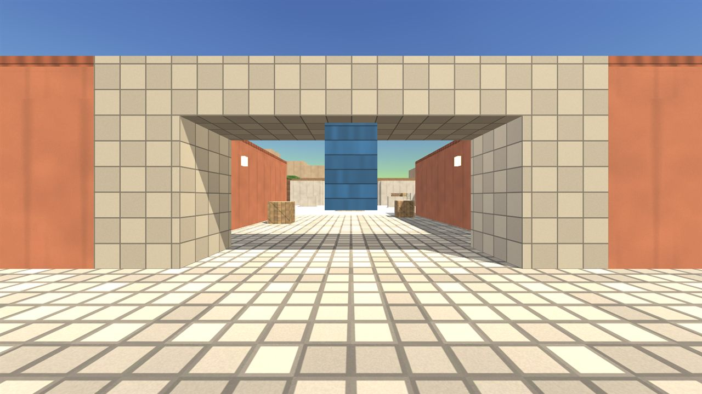
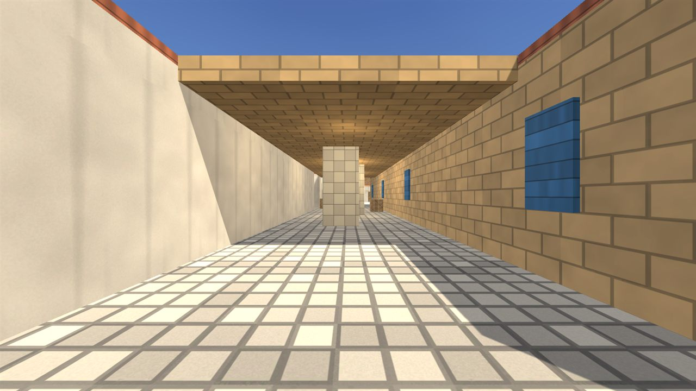
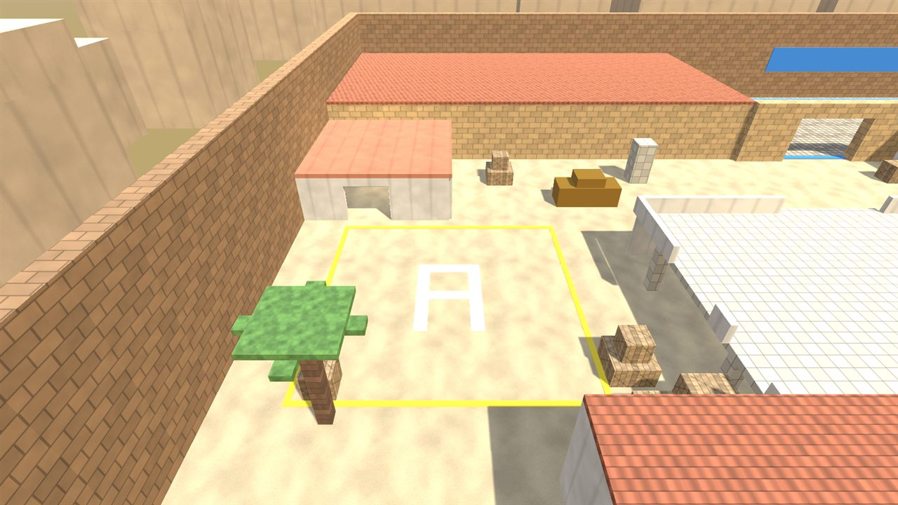
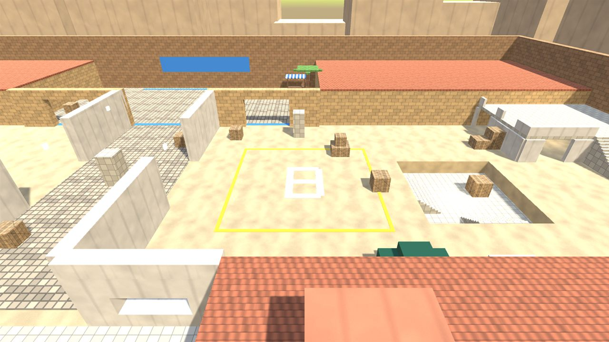

# Bazaar map

Daylight desert-town tactical map in the Valorant / CS style: two bomb sites, three routes into each site,
attacker and defender yards, long sightlines on one lane only, doors and corners with deliberate angles.
Original geometry, generated materials, textures and sky only. The look is clean and sunny (sand, limestone,
terracotta roofs, whitewashed walls, coloured awnings), different from Shipment (neon), Dome (sci-fi), Triad (dusk).

The bomb / round mode is **not** implemented. The map only carries the markers a future mode needs: plant zones
and buy zones as trigger volumes with a `BazaarPlantZone` component.



## Layout (top view, +Z up, metres, origin at the map centre)

```
 z=+62  +-------------------------------------------------------------+
        |                  DEFENDER YARD (buy zone, spawns)           |
 z=+47  +-------------+------------+--------+-------------+-----------+
        |   A SITE    |  A heaven  | HUB    |   B SITE    | B balcony |
        |  (plant A)  |  A hell    | rotate |  (plant B)  | B room    |
 z=+26  |  A room     |            | doors  |  sunken pit |           |
        +------+------+------+-----+--------+------+------+-----+-----+
        |      |  A SHORT -> stairs to heaven      | B CONNECTOR     |
        | A    +-----+      +---------------+      +--+  B          |
        | LONG |     |      |  MID COURTYARD |      |  TUNNELS      |
        | (the | blk |      |  fountain,     | blk  |  (pillars)    |
        | only |     |      |  top-mid exit, |      |  B window     |
        | long |     |      |  B window      |      |               |
        | line)+-----+      +--------+-------+      +---------------+
 z=-29  +------+--------------+ MID GATE +----------+--------------+
        |        FORECOURT STREET (market stalls, cars, palms)       |
 z=-42  +-------------+------------+--------+-------------+----------+
        |                ATTACKER YARD (buy zone, spawns)             |
 z=-62  +-------------------------------------------------------------+
       x=-55         x=-30        x=0      x=+30                x=+55
```

Walls are 9 m high around the map and 5 m on the building masses. The street is at y = 0, decks (heaven) at
y = 3 and the B pit at y = -1.5.



## Routes

| Route | Description |
| --- | --- |
| **A Long** | West lane x -55 to -41, the only long sightline (36 m or more), crates and a market stall for cover |
| **A Short** | Corridor at z 0 to 6 with a 15-step staircase up to the A heaven landing (y = 3) |
| **Mid** | Street from the mid gate into a courtyard with a fountain, a top-mid exit and a window (sill 1.1 m) onto B |
| **B Connector** | Courtyard to B site via a doored connector |
| **B Tunnels** | East lane x 34 to 42, a covered tunnel with staggered pillars so no straight long line |
| **Hub / Rotate** | Defender rotate path x -6 to 6, z 16 to 44, with doors at z 26 to 34 that connect to both sites |

Each site has three room types: a default room (A: x -55 to -45, z 34 to 44), heaven (elevated deck), and hell
(the room under the A deck, and the sunken B pit with two stairs).





## Sites and markers

| Object | Where | Notes |
| --- | --- | --- |
| `PlantZone_A` | centre (-45, 26) | Trigger box with `BazaarPlantZone` (Plant, site A); painted yellow outline and white letter A |
| `PlantZone_B` | centre (18, 30) | Trigger box with `BazaarPlantZone` (Plant, site B); painted yellow outline and white letter B |
| `BuyZone_Attack` | south yard | Trigger box with `BazaarPlantZone` (Buy), attackers |
| `BuyZone_Defend` | north yard | Trigger box with `BazaarPlantZone` (Buy), defenders |

Each site has a crate jump route to its deck (hops of 1.1, 1.1 and 0.8 m, within bunny hop / mantle range) and a
3 m drop, for players only.




## Build the scene

The scene file is generated, not hand-authored:

- Unity menu: `Tools > Maps > Build Bazaar` (then `Tools > Maps > Open Bazaar` / `Enter Bazaar Play Mode`)
- CLI: `Unity -batchmode -projectPath . -executeMethod FpsMaps.Bazaar.EditorTools.BazaarMapBuilder.BuildBatch -quit`

The builder writes `Assets/Scenes/Bazaar.unity`, generates textures, materials and a procedural skybox under
`Assets/Maps/Bazaar`, spawns the `PlayerCharacter` prefab at `PlayerSpawn` and adds the scene to Build Settings.
Re-running it regenerates everything.

## Code

- `Scripts/BazaarLayout.cs`, `BazaarLayoutData.cs`: the whole layout as pure data (boxes, openings, stairs, spawns,
  waypoints, areas, routes, zones). The builder and the tests read the same data.
- `Scripts/BazaarPlantZone.cs`: marker component (zone kind and site) for plant and buy zones. It has no runtime
  behaviour yet.
- `Shaders/BazaarWorldTiled.shader`: world-space triplanar tiling used by every surface.
- `Assets/Editor/BazaarMapBuilder.cs`, `BazaarMapAssets.cs`: scene and asset generation.
- `Tests/Editor`: layout contract tests (axis-aligned geometry, sightlines, openings, stairs, jump and mantle limits,
  spawns and waypoints clear of geometry, routes, zones).
- `Tests/PlayMode`: loads the generated scene and checks the player, tagged spawns, lighting, colliders, zones,
  NavMesh connectivity between spawns and every waypoint, and a real bot walk of each route
  (`ALong`, `AShort`, `Mid`, `BTunnels`, `BConnector`, `ASite`, `BSite`, `Rotate`).

Spawns are tagged `Respawn` (attackers in the south yard, `PlayerSpawn` first; defenders in the north yard).
Bots use the shared runtime NavMesh built from colliders and patrol `BotWaypoint` markers grouped per route.

## Movement and bot notes and assumptions

- Every world collider is on the `Default` layer so wall run, slide and mantle see all geometry. Backdrop buildings
  outside the walls have no colliders.
- Bots cannot jump or drop, so every walkable area is reachable by stairs or doors. The crate jump routes and drops
  are player-only extras.
- Low solid props of 0.55 m or less are avoided because they can trap bots.
- The slide gap feature was not added in this milestone.
- Hotkey in the map selector: `End` (or cycle with PgUp/PgDn).
