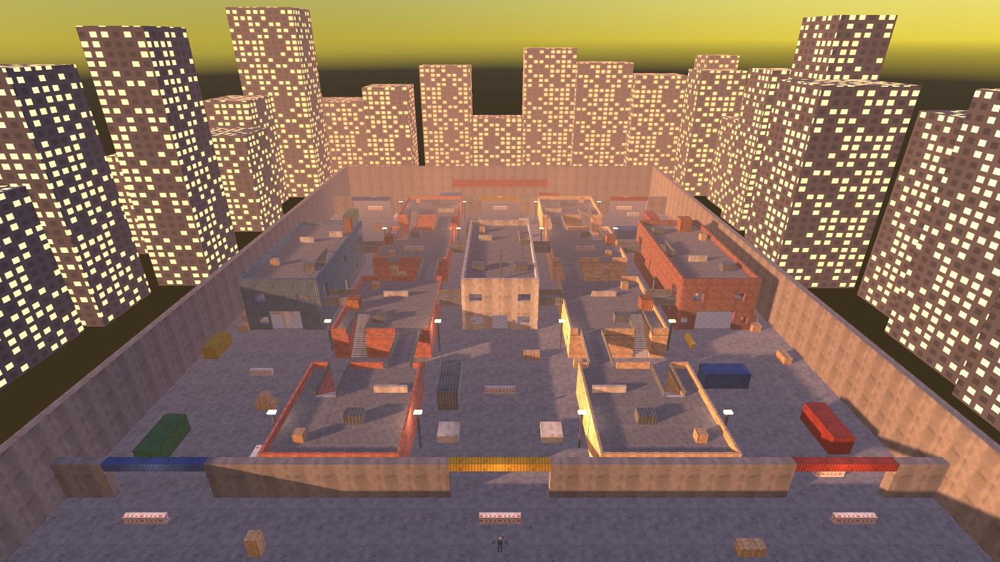
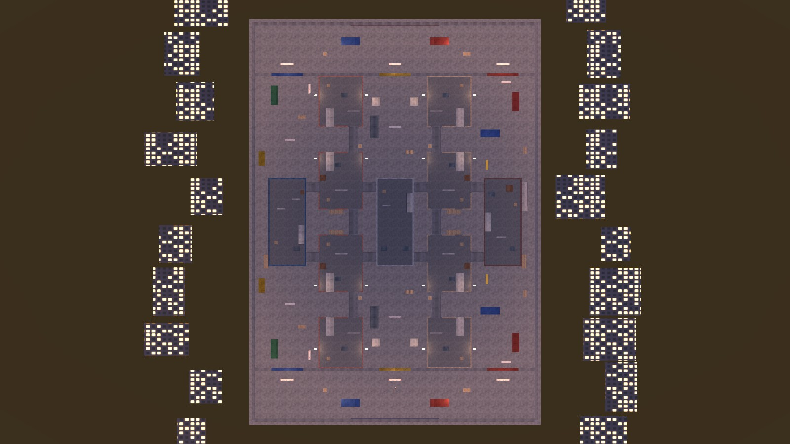
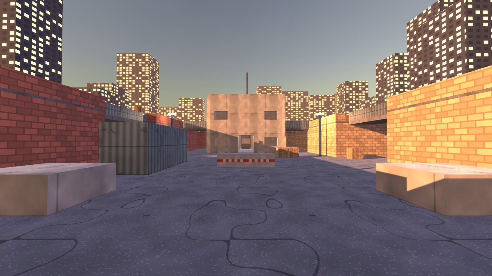
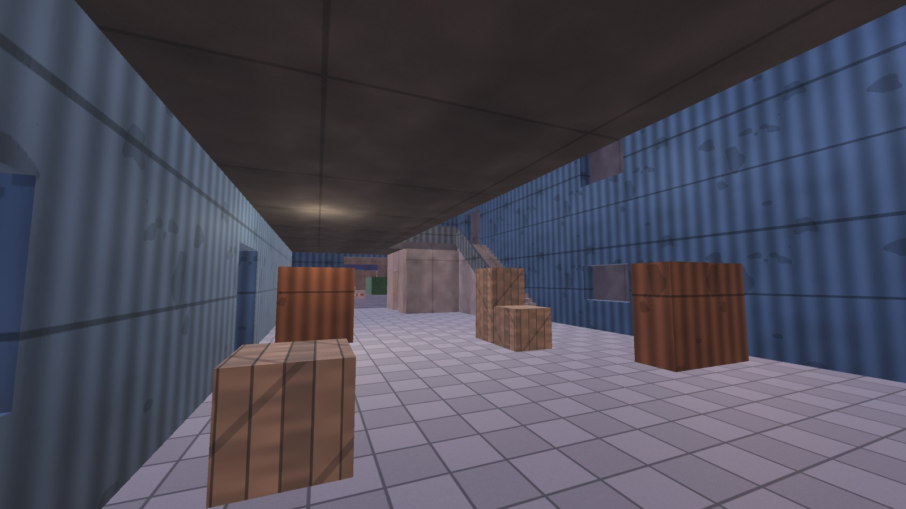
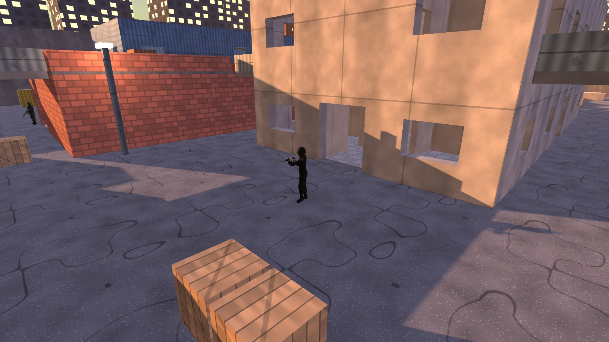

# Triad map

Dusk city grey-box built on the number three: three lanes, three height tiers and three enterable buildings
(original geometry, generated materials/textures only). Lighting is deliberately different from Shipment
(neon night) and Dome (futuristic): a low warm sun, procedural dusk sky, light fog and a lit skyline.



## The 3 x 3 x 3

- 3 lanes, 20 m wide, running south to north: West (x = -34), Middle (x = 0) and East (x = 34).
- 3 tiers: street (y = 0), mid (y = 4: block roofs, upper floors, bridges) and high (y = 8: building roofs).
- 3 enterable buildings, one per lane, each two storeys plus a roof: Warehouse (west), Office (middle),
  Depot (east). Each has street doors, windows you can see through, internal stairs to the upper floor and on to the
  roof, and its own cover.

Two spawn yards close the map at the ends: south (team A, z -62 to -47) and north (team B, z 47 to 62).
The yard gates lead into the three lanes. Two city blocks (x +-10 to +-24) separate the lanes; alleys cut
through them and bridges at y = 4 link blocks and buildings.

## Layout (top view, +Z up)

```
 z=+62  +---------------+-----+----------------+-----+---------------+
        |                    NORTH YARD  (team B)                   |
 z=+47  +---------------+-----+----------------+-----+---------------+
        |               |     |                |     |               |
        |   WAREHOUSE   | blk |     OFFICE     | blk |     DEPOT     |
        |   west lane   |     |  middle lane   |     |   east lane   |
        |               |     |                |     |               |
 z=-47  +---------------+-----+----------------+-----+---------------+
        |                    SOUTH YARD  (team A)                   |
 z=-62  +---------------+-----+----------------+-----+---------------+
       x=-44   x=-34  x=-24..-10     x=0      x=10..24    x=34   x=44
```

Tiers: street y = 0, mid y = 4, high y = 8. Stairs rise 0.2 m per 0.3 m step.



## Build the scene

The scene file is generated, not hand-authored:

- Unity menu: `Tools > Maps > Build Triad` (then `Tools > Maps > Open Triad` / `Enter Triad Play Mode`)
- CLI: `Unity -batchmode -projectPath . -executeMethod FpsMaps.Triad.EditorTools.TriadMapBuilder.BuildBatch -quit`

The builder writes `Assets/Scenes/Triad.unity`, generates textures and materials under
`Assets/Maps/Triad/Textures` and `Materials`, spawns the `PlayerCharacter` prefab at `PlayerSpawn` and adds
the scene to Build Settings. Re-running it regenerates everything.

## Code

- `Scripts/TriadLayout.cs`, `TriadLayoutData.cs`: the whole layout as pure data (boxes, openings, stairs,
  spawns, waypoints, areas, routes). The builder and the tests read the same data, so they cannot drift apart.
- `Shaders/TriadWorldTiled.shader`: world-space triplanar tiling used by every surface.
- `Assets/Editor/TriadMapBuilder.cs`, `TriadMapAssets.cs`: scene and asset generation.
- `Tests/Editor`: layout contract tests (lane, tier and building counts, openings, walkable stairs, jump and mantle
  limits, spawns and waypoints clear of geometry).
- `Tests/PlayMode`: loads the generated scene and checks the player, tagged spawns (not inside geometry),
  NavMesh connectivity between all waypoints, and a real bot walk-through of each lane and each building.

Spawns are tagged `Respawn`; `PlayerSpawn` is in the south yard. Bots use the shared runtime NavMesh built from
colliders (no baked data) and patrol `BotWaypoint` markers named per route: `LaneWest`, `LaneMiddle`,
`LaneEast`, `Warehouse`, `Office`, `Depot`.

## Movement and bot notes

Every world collider is on the `Default` layer, so wall run, slide and mantle see all geometry. Decor
(skyline, lamps, signs) has no colliders. Stairs and ramps are shallow enough for the controller's step
offset and for bots, which cannot jump; the crate stacks that give players a mantle route onto roofs are
extra, not required for bots. Stair approaches are wide and axial on purpose because bots get stuck in
narrow, winding stair entries.

Hotkey in the map selector: `Home` (F1-F12 and Backslash are taken by other maps), or cycle with PgUp/PgDn.




