# fps1: CoD-style movement shooter

A first-person shooter prototype built in **Unity 6 (6000.6.10f1)** around tight, skill-based movement
(slide cancelling, bunny hopping, dolphin dives, air strafing, wall bounces) and a small set of arenas,
weapons and cosmetics to try it all out. Everything you see is generated from code or scripts in this repo:
procedural humanoids and first-person arms, primitive-built guns, generated map scenes, shader-driven weapon skins.

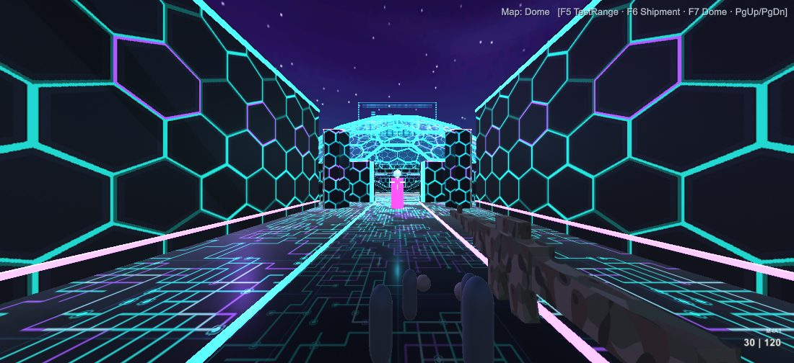

## Contents

- [Features](#features)
- [Screenshots](#screenshots)
- [Controls](#controls)
- [Getting started](#getting-started)
- [Project layout](#project-layout)
- [Tests](#tests)
- [Blender and generator tooling](#blender-and-generator-tooling)
- [More documentation](#more-documentation)

## Features

### Movement

Tuned through `MovementConfig` assets (`Assets/Configs`), implemented in `Assets/Scripts/Movement`.

- **Slide and slide cancel**: crouch while sprinting to slide, press Space mid-slide to cancel into a jump with a horizontal boost.
- **Bunny hop**: hold Space through landings (or tap it just before touching down) to chain hops and keep speed.
- **Dolphin dive**: dive forward out of a sprint; short cooldown.
- **Air strafing**: hold A or D in the air to build speed.
- **Wall bounce**: jump into a wall at speed and press Space to bounce off it.
- **Movement archetypes**: Default, Scout, Heavy, Acrobat and Marksman configs, plus per-class speed multipliers.
- **Movement feedback**: slide dust, landing and wall sparks, camera shake and roll, procedural placeholder sounds.

### Weapons and attachments

Gun prefabs live in `Assets/Weapons/Prefabs`, stats in `Assets/Configs/Weapons`.

| Weapon | Type | Notes |
| --- | --- | --- |
| M4A1 | Assault rifle | Carry handle and handguard |
| SCAR | Assault rifle | Heavier receiver |
| UMP | SMG | Compact, angled magazine |
| Bolt-Action Sniper | Sniper | Scope on a rail, bipod mounted on a fore-end |
| DMR | Semi-auto marksman rifle | Rail-mounted optic |
| Pump Shotgun | Shotgun | Fires 9 pellets per shot, per-shell reload that can be cancelled by firing |
| LMG | Light machine gun | Belt-fed, 100-round box, folded bipod, slow reload |
| Karambit | Melee knife | Secondary on every class; imported Blender model with a procedural fallback |

Attachments are modelled as parts of the weapon prefabs: scopes with mounting rings and rails on both snipers, a bipod
on the bolt-action sniper and the LMG. The karambit swings through `MeleeAttackResolver` (five short rays per slash)
and plays an alternating forehand and backhand slash. Details are in [`Assets/Weapons/README.md`](Assets/Weapons/README.md).

### Weapon skins

20 skins that work on any gun mesh through object-space triplanar projection (Built-in Render Pipeline shaders):

- **Static (12):** Woodland Camo, Arctic Digital, Honeycomb, Prism, Halftone Pop, Damascus, Desert Tiger, Urban Hex,
  Carbon Fiber, Copper Patina, Kryptek Fracture, Night Viper.
- **Animated (8):** Scrolling Energy, Pulsing Emissive, Holographic, Flowing Lava, Neon Rain, Chromatic Shift, Storm Arc, Ember Ash.

`WeaponSkinApplier` sits on every weapon prefab. In Play Mode, `[` and `]` run the **skin cycler**
(`TestRangeSkinCycler`) through the whole skin catalog for the active weapon. See [`Assets/Skins/README.md`](Assets/Skins/README.md).

### Loadout menu and classes

- Press `Esc` (pause menu) or `L` (straight to the Loadout tab) to pick a class, a primary, a secondary and a skin per weapon, with a live rotating preview. Choices apply immediately and persist in `PlayerPrefs`.
- Classes switch on the fly with `F1` to `F4`:

| Key | Class | Primary | Secondary | Speed |
| --- | --- | --- | --- | --- |
| `F1` | Assault | M4A1 | Karambit | x1.00 |
| `F2` | SMG | UMP | Karambit | x1.08 |
| `F3` | Sniper | Bolt-Action Sniper | Karambit | x0.94 |
| `F4` | Hybrid | DMR | Karambit | x1.00 |

The menu can override any slot (including the shotgun and LMG), so the class is just a starting point.

### Maps

| Map | Scene | Hotkey | Description |
| --- | --- | --- | --- |
| **TestRange** | `Assets/Scenes/TestRange.unity` | `F5` | Open grey range with walls, ramps and bots, built for practising movement and shooting |
| **Shipment** | `Assets/Scenes/Shipment.unity` | `F6` | Tiny futuristic reskin of the classic container yard: neon-lit stacks, open centre lane, jumpable container tops |
| **Dome** | `Assets/Scenes/Dome.unity` | `F7` | Arena around a hex-panel energy-glass geodesic dome with a ring catwalk, towers and holo displays |

The **map selector** switches maps at runtime with `F5`/`F6`/`F7`, cycles with `PgUp`/`PgDn`, and shows the current map in the top-right corner.
There is also a **MAP** tab in the `Esc` menu. The maps are generated by editor tools (see [Getting started](#getting-started)).

### Characters

- **Procedural humanoid bodies** for the player and the target bots: 19 bones, built at runtime, animated in code (idle, walk and strafe, crouch, slide, airborne, dive) with two-bone IK. No animation clips or imported meshes.
- **First-person arms** that follow the weapon holder and grip each gun.

## Screenshots

### Maps

TestRange, Shipment and Dome from several sides.

| | |
| --- | --- |
|  |  |
| 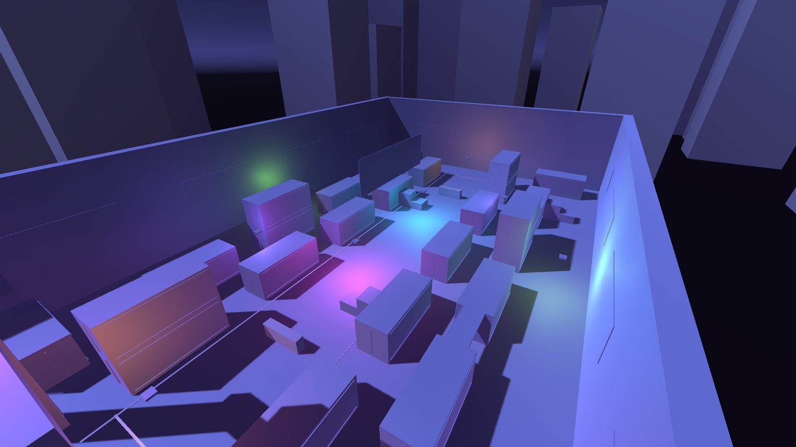 | 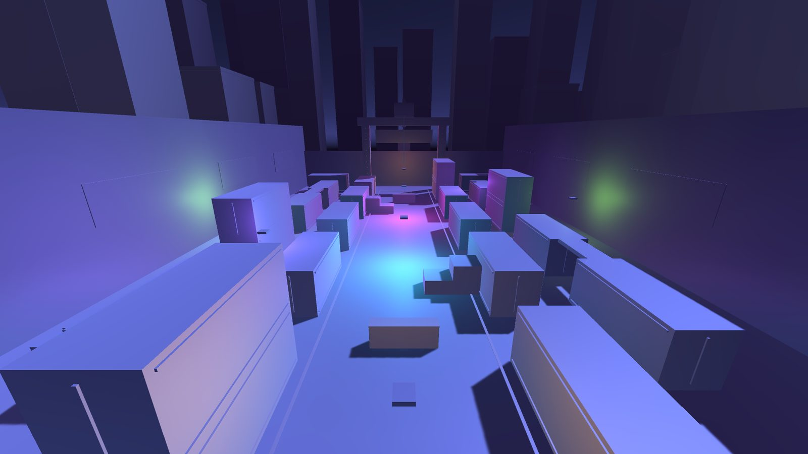 |
| 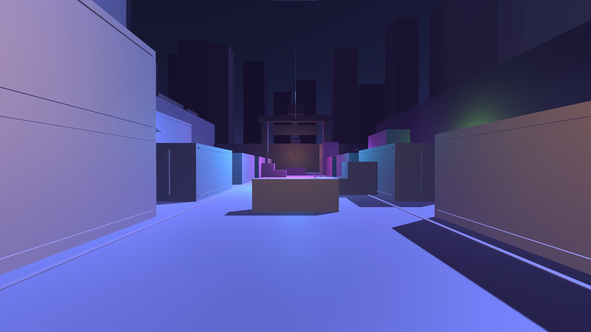 | 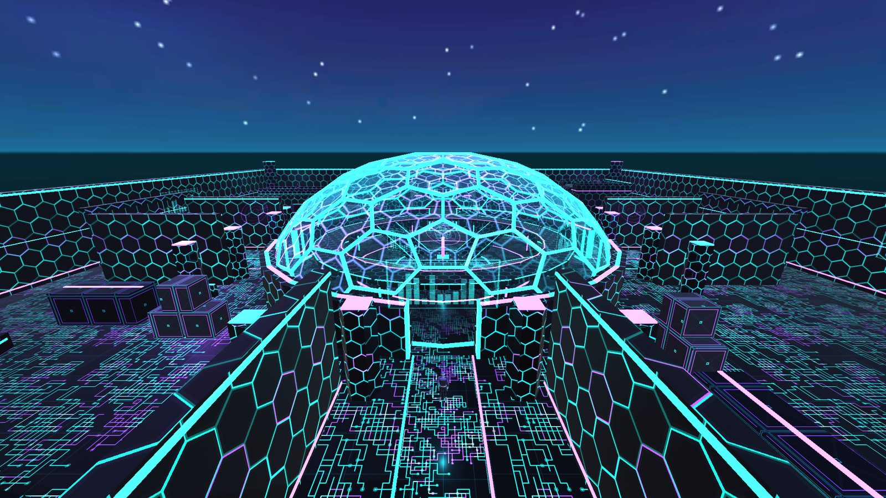 |
| 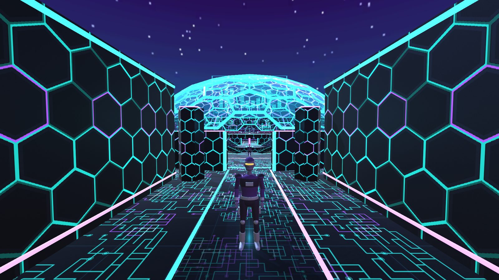 |  |

### Menus

The loadout menu (`L` or `Esc`), with the map label shown top right. The map selector label is the first image on this page.

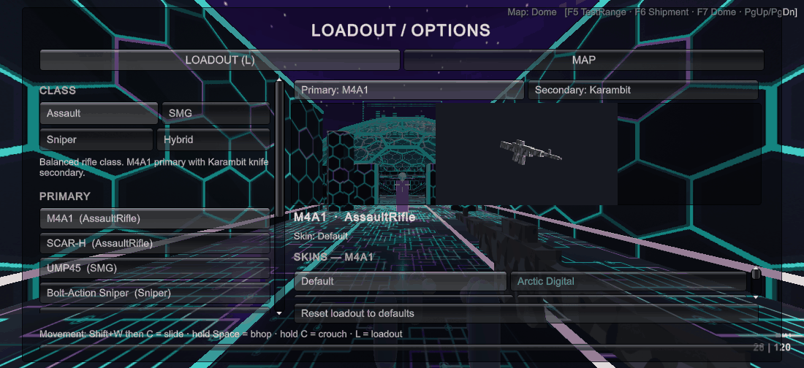

### Characters

| | | |
| --- | --- | --- |
| 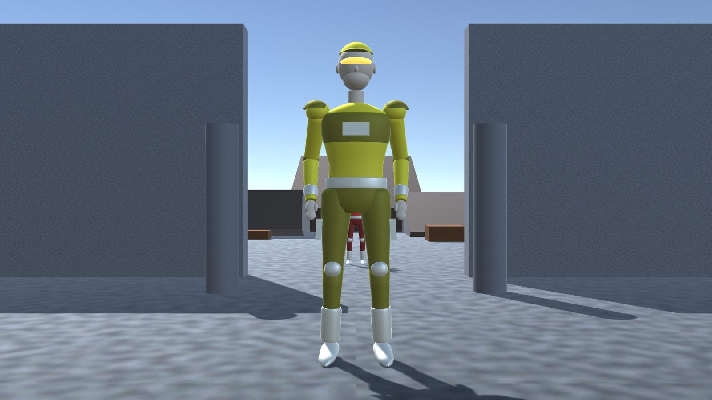 | 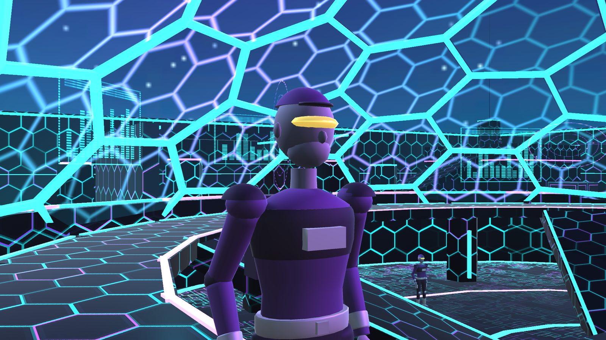 | 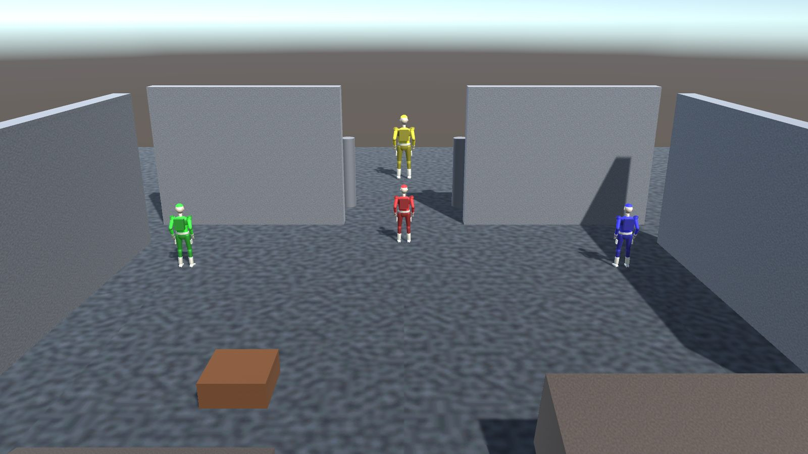 |

### First-person weapons

| | |
| --- | --- |
| 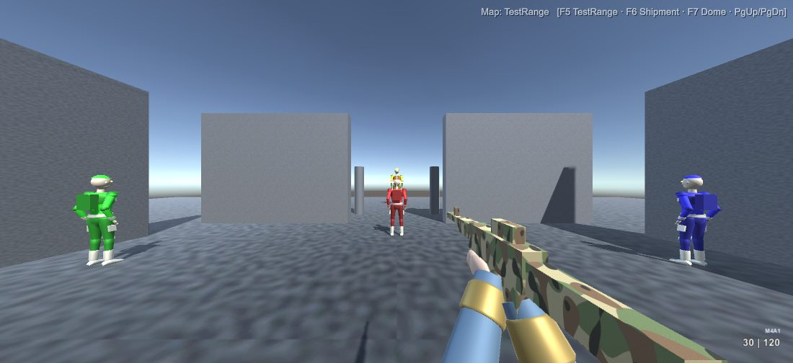 | 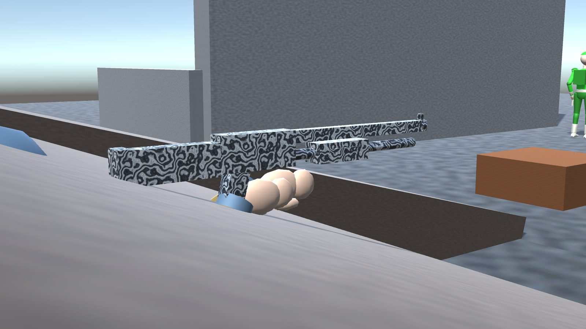 |
| 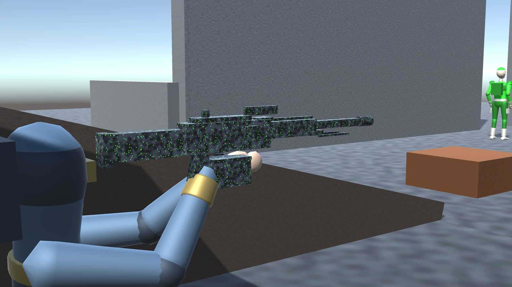 | 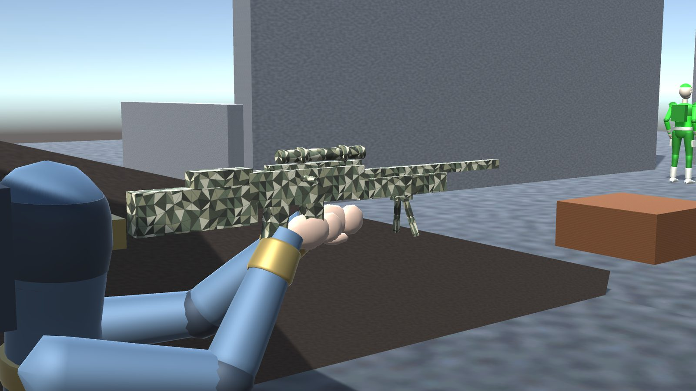 |
| 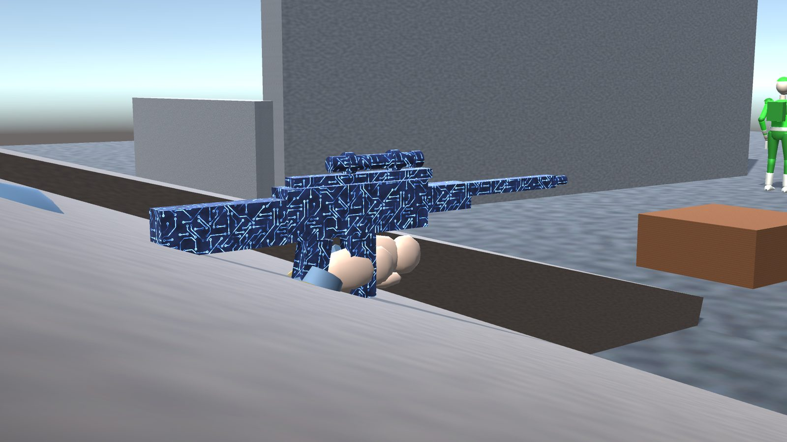 |  |

The karambit as modelled in Blender (`Tools/Blender/build_karambit.py`):

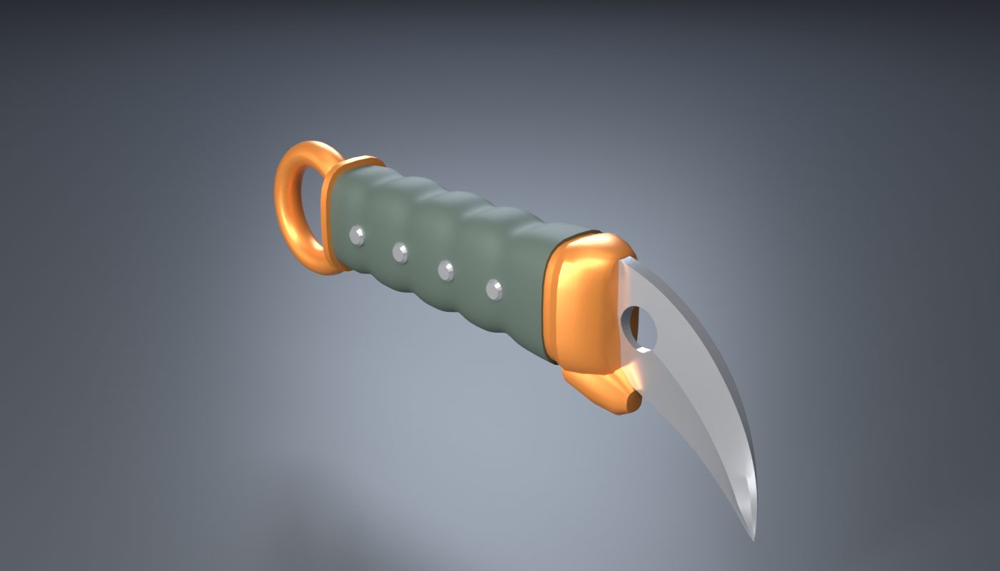

### Skins

Static skin textures (one tile each):


Animated skins on the DMR, shotgun and karambit (still frames of shaders that animate in game):


## Controls

Legacy Input Manager. Source of truth: [`Assets/Scenes/TestRange_Controls.md`](Assets/Scenes/TestRange_Controls.md) and the input code in `Assets/Scripts`.

### Movement and combat

| Action | Keys |
| --- | --- |
| Move | `W` `A` `S` `D` or arrow keys |
| Look | Mouse (cursor is locked in play; `Esc` opens the menu and unlocks it) |
| Jump | `Space` |
| Sprint | `Left Shift` |
| Crouch / slide | `C` or `Left Ctrl` |
| Dolphin dive | `V` while sprinting |
| Fire | Left mouse |
| Aim down sights | Right mouse |
| Reload | `R` |
| Primary / secondary | `1` / `2` |
| Cycle weapons | Mouse wheel |
| Last weapon | `Q` |

### Menus and cosmetics

| Action | Keys |
| --- | --- |
| Loadout menu | `L` (Loadout tab) or `Esc` (pause menu) |
| Class | `F1` Assault, `F2` SMG, `F3` Sniper, `F4` Hybrid |
| Map | `F5` TestRange, `F6` Shipment, `F7` Dome, `PgUp` / `PgDn` to cycle |
| Cycle skin | `[` previous, `]` next (active weapon) |

### Movement techniques

| Technique | How |
| --- | --- |
| Slide | Sprint (`Shift` + `W`) to roughly 4 m/s or more, then tap `C` / `Ctrl` |
| Slide cancel | Press `Space` while sliding for a horizontal boost jump |
| Bunny hop | Hold `Space` through landings, or tap it within about 0.15 s of landing |
| Dolphin dive | Sprint, then `V` (cooldown about 1.2 s) |
| Air strafe | Hold `A` or `D` in the air while moving; gains come from the air control values in `MovementConfig` |
| Wall bounce | Jump toward a wall at about 6 m/s or faster, then `Space` near it |

Walls need a collider on the `Default` layer to be bounceable. If jumps or slides never register but `WASD` works,
run **Tools > Sync Test Range Player (Character + Classes)**.

## Getting started

1. Install **Unity 6000.6.10f1** (pinned in `ProjectSettings/ProjectVersion.txt`). The project uses the Built-in Render Pipeline and the legacy Input Manager.
2. Open the repository root as a project in Unity Hub and let it import.
3. Open a scene from `Assets/Scenes` (`TestRange`, `Shipment` or `Dome`) and press Play. Maps can also be switched in play with `F5`/`F6`/`F7`.

The `Tools` menu holds the editor utilities:

| Menu item | What it does |
| --- | --- |
| `Tools > Build Test Range`, `Open Test Range Scene`, `Enter Test Range Play Mode` | Rebuild, open or play the TestRange scene |
| `Tools > Maps > Build Shipment` / `Open Shipment` / `Enter Shipment Play Mode` | Regenerate, open or play Shipment |
| `Tools > Maps > Build Dome` / `Open Dome` / `Enter Dome Play Mode` | Regenerate, open or play Dome |
| `Tools > Sync Test Range Player (Character + Classes)` | Re-sync the scene player (character, ground check, camera refs, classes) |
| `Tools > Sync Test Range Weapon Loadout` | Put the weapon prefabs into the TestRange weapon switcher |
| `Tools > Loadout > Rebuild Weapon Catalog` | Regenerate `Assets/Resources/WeaponLoadoutCatalog.asset` after adding weapons, skins or classes |
| `Tools > Skins > Rebuild Weapon Skin Catalog` | Regenerate the skin catalog used by the skin cycler (an EditMode test fails if it is stale) |
| `Tools > Classes > ...` | Create the default class definitions, add the class applier, apply a class to the scene player |
| `Tools > Movement > ...` | Ensure the movement configs, add feedback, apply an archetype config to the scene player |
| `Tools > Build Player Character Prefab` | Regenerate the `PlayerCharacter` prefab |
| `Tools > Run Play Mode Smoke Check` | Quick play-mode sanity run |

Map scenes can also be built headless, for example
`Unity -batchmode -projectPath . -executeMethod ShipmentMapBuilder.BuildBatch -quit`
(Dome: `FpsMaps.Dome.EditorTools.DomeMapBuilder.BuildBatch`).

## Project layout

```
Assets/
  Scenes/          TestRange, Shipment, Dome scenes + TestRange_Controls.md
  Scripts/         Movement, Player, Weapons, Characters (procedural humanoid), Classes, Maps, Targets
  Loadout/         Loadout menu, catalog, selection store, preview rig
  Weapons/         Gun prefabs, materials, imported karambit model, weapon README
  Skins/           Skin shaders, textures, materials, definitions, applier; Tools~ has the Python texture generators
  Classes/         Class definition assets (Assault, SMG, Sniper, Hybrid)
  Configs/         MovementConfig archetypes and per-weapon WeaponConfig assets
  Characters/      PlayerCharacter prefab and notes
  Maps/            Shipment and Dome scripts, shaders, materials, textures and tests
  Resources/       Weapon loadout catalog and runtime-loaded audio
  Editor/          Map builders, scene sync tools and the Tools menu items
  Tests/           EditMode (Editor) and PlayMode test assemblies
Tools/
  Blender/         Headless Blender 4.2.3 generators (karambit model and held-pose preview)
  WeaponGen/       Python generator for the shotgun and LMG prefabs
  Weapons/         Python script that mounts sniper scopes and bipods
docs/
  screenshots/     Images used by this README
```

## Tests

Unity Test Framework (`com.unity.test-framework` 1.4.5). Open **Window > General > Test Runner**
and pick EditMode or PlayMode, or run them headless:

```bash
# EditMode
Unity -batchmode -projectPath . -runTests -testPlatform EditMode -testResults EditModeResults.xml

# PlayMode
Unity -batchmode -projectPath . -runTests -testPlatform PlayMode -testResults PlayModeResults.xml
```

- **EditMode** (`Assets/Tests/Editor`, plus `Assets/Maps/*/Tests`): movement logic, hit detection, class and loadout selection, skin catalog and applier, humanoid body, melee, shotgun and LMG configs, sniper mounting, map catalog, and map layout and geometry contracts.
- **PlayMode** (`Assets/Tests/PlayMode`, plus `Assets/Maps/*/Tests`): TestRange smoke tests, movement techniques such as bunny hop, humanoid bodies in scene, map selector, loadout menu, melee, shotgun and LMG, and the Shipment and Dome scenes (the generated scene has to exist first, so build the map before running its PlayMode tests).

## Blender and generator tooling

Models that need more than primitives are authored in code and exported into the Unity project, so they can be rebuilt without opening a DCC tool:

- `Tools/Blender/` holds headless generators for **Blender 4.2.3**. Today that is the karambit (`build_karambit.py`, exports FBX and GLB into `Assets/Weapons/Models/Karambit`) and a held-pose preview renderer (`preview_karambit_held.py`):

  ```bash
  blender -b --factory-startup --python Tools/Blender/build_karambit.py -- \
      --out Assets/Weapons/Models/Karambit [--renders <dir>]
  ```

- More detailed character and weapon models are being added to this folder. Each generator is a standalone script with its own usage notes at the top, so new ones are documented in place and listed here as they land.
- `Tools/WeaponGen/build_shotgun_lmg.py` and `Tools/Weapons/mount_sniper_parts.py` are plain Python (no Blender) that write or edit prefab YAML.
- `Assets/Skins/Tools~/` holds the Python texture generators for weapon skins.

## More documentation

- [`Assets/Scenes/TestRange_Controls.md`](Assets/Scenes/TestRange_Controls.md): keys, movement tech, loadout menu
- [`Assets/Weapons/README.md`](Assets/Weapons/README.md): weapon prefabs, shotgun and LMG, karambit, sniper mounting
- [`Assets/Skins/README.md`](Assets/Skins/README.md): skin system and how to add skins
- [`Assets/Classes/README.md`](Assets/Classes/README.md): classes and the loadout menu service
- [`Assets/Configs/Movement/README.md`](Assets/Configs/Movement/README.md): movement archetypes and feedback
- [`Assets/Characters/Player/README.md`](Assets/Characters/Player/README.md): procedural humanoid player
- [`Assets/Maps/Shipment/README.md`](Assets/Maps/Shipment/README.md), [`Assets/Maps/Dome/README.md`](Assets/Maps/Dome/README.md): map layouts and build steps
