# fps1: CoD-style movement shooter

A first-person shooter prototype built in **Unity 6 (6000.6.10f1)** around tight, skill-based movement
(slide cancelling, bunny hopping, dolphin dives, air strafing, wall bounces) and a small set of arenas,
weapons and cosmetics to try it all out. Everything you see is generated from code or scripts in this repo, with no downloaded assets:
Blender-built guns and soldier (with procedural fallbacks), generated map scenes, shader-driven weapon skins.


## Contents

- [Features](#features)
- [Screenshots](#screenshots)
- [Controls](#controls)
- [Getting started](#getting-started)
- [Project layout](#project-layout)
- [Tests](#tests)
- [Blender models and tooling](#blender-models-and-tooling)
- [More documentation](#more-documentation)

## Features

### Movement

Tuned through `MovementConfig` assets (`Assets/Configs`), implemented in `Assets/Scripts/Movement`.

- **Slide and slide cancel**: crouch while sprinting to slide, press Space mid-slide to cancel into a jump with a horizontal boost.
- **Bunny hop**: hold Space through landings (or tap it just before touching down) to chain hops and keep speed.
- **Dolphin dive**: dive forward out of a sprint; short cooldown.
- **Air strafing**: hold A or D in the air to build speed.
- **Wall bounce**: jump into a wall at speed and press Space to bounce off it.
- **Movement archetypes**: Default, Scout, Heavy, Acrobat and Marksman configs, plus per-class speed multipliers.
- **Movement feedback**: slide dust, landing and wall sparks, camera shake and roll, procedural placeholder sounds.

### Weapons and attachments

Gun prefabs live in `Assets/Weapons/Prefabs`, stats in `Assets/Configs/Weapons`. Every visible gun model is a
detailed model generated headless in Blender (`Assets/Weapons/Models`), with the original primitive-built parts kept
in each prefab as an automatic fallback (see [Blender models and tooling](#blender-models-and-tooling)).

| Weapon | Type | Notes |
| --- | --- | --- |
| M4A1 | Assault rifle | Carbine with rail handguard and charging handle |
| SCAR-H | Assault rifle | Heavier battle rifle |
| UMP45 | SMG | Compact, angled magazine |
| Bolt-Action Sniper | Sniper | Scope on a rail, bipod mounted on a fore-end |
| DMR | Semi-auto marksman rifle | Rail-mounted optic, quad-rail handguard |
| Pump Shotgun | Shotgun | Fires 9 pellets per shot, per-shell reload that can be cancelled by firing |
| LMG | Light machine gun | Belt-fed, 100-round box, folded bipod, slow reload |
| Karambit | Melee knife | Secondary on every class |

The eight weapons above are what the loadout menu offers. A pistol (Blender model, animated slide) is also on the player
prefab as the test sidearm, but it is not in the loadout catalog.

Attachments are modelled as parts of the weapon models: scopes with mounting rings and rails on both snipers, a bipod
on the bolt-action sniper and the LMG. The karambit swings through `MeleeAttackResolver` (five short rays per slash)
and plays an alternating forehand and backhand slash. Details are in [`Assets/Weapons/README.md`](Assets/Weapons/README.md).

### Weapon skins

20 skins that work on any gun mesh through object-space triplanar projection (Built-in Render Pipeline shaders):

- **Static (12):** Woodland Camo, Arctic Digital, Honeycomb, Prism, Halftone Pop, Damascus, Desert Tiger, Urban Hex,
  Carbon Fiber, Copper Patina, Kryptek Fracture, Night Viper.
- **Animated (8):** Scrolling Energy, Pulsing Emissive, Holographic, Flowing Lava, Neon Rain, Chromatic Shift, Storm Arc, Ember Ash.

`WeaponSkinApplier` sits on every weapon prefab. In Play Mode, `[` and `]` run the **skin cycler**
(`TestRangeSkinCycler`) through the whole skin catalog for the active weapon. See [`Assets/Skins/README.md`](Assets/Skins/README.md).

### Loadout menu and classes

- Press `Esc` (pause menu) or `L` (straight to the Loadout tab) to pick a class, a primary, a secondary and a skin per weapon, with a live rotating preview. Choices apply immediately and persist in `PlayerPrefs`.
- Classes switch on the fly with `F1` to `F4`:

| Key | Class | Primary | Secondary | Speed |
| --- | --- | --- | --- | --- |
| `F1` | Assault | M4A1 | Karambit | x1.00 |
| `F2` | SMG | UMP | Karambit | x1.08 |
| `F3` | Sniper | Bolt-Action Sniper | Karambit | x0.94 |
| `F4` | Hybrid | DMR | Karambit | x1.00 |

The menu can override any slot (including the shotgun and LMG), so the class is just a starting point.

### Maps

| Map | Scene | Hotkey | Description |
| --- | --- | --- | --- |
| **TestRange** | `Assets/Scenes/TestRange.unity` | `F5` | Open grey range with walls, ramps and bots, built for practising movement and shooting |
| **Shipment** | `Assets/Scenes/Shipment.unity` | `F6` | Tiny futuristic reskin of the classic container yard: neon-lit stacks, open centre lane, jumpable container tops |
| **Dome** | `Assets/Scenes/Dome.unity` | `F7` | Arena around a hex-panel energy-glass geodesic dome with a ring catwalk, towers and holo displays |

The **map selector** switches maps at runtime with `F5`/`F6`/`F7`, cycles with `PgUp`/`PgDn`, and shows the current map in the top-right corner.
There is also a **MAP** tab in the `Esc` menu. The maps are generated by editor tools (see [Getting started](#getting-started)).

### Characters

- **Blender-built soldier** (`Assets/Characters/Models/Soldier.fbx`, about 31k triangles) for the player and the target bots, skinned at runtime onto a 19-bone humanoid rig and tinted through the humanoid palette (target colours, hit flash).
- **Code-driven animation**: idle, walk and strafe, crouch, slide, airborne and dive poses with two-bone IK, no animation clips needed.
- **First-person arms** (`SoldierArmsFP.fbx`) that follow the weapon holder and grip each gun.
- **Procedural fallback**: if the soldier model is missing or fails validation, the older primitive-built procedural humanoid and arms are used instead.

## Screenshots

### Maps

TestRange, Shipment and Dome from several sides.

| | |
| --- | --- |
| 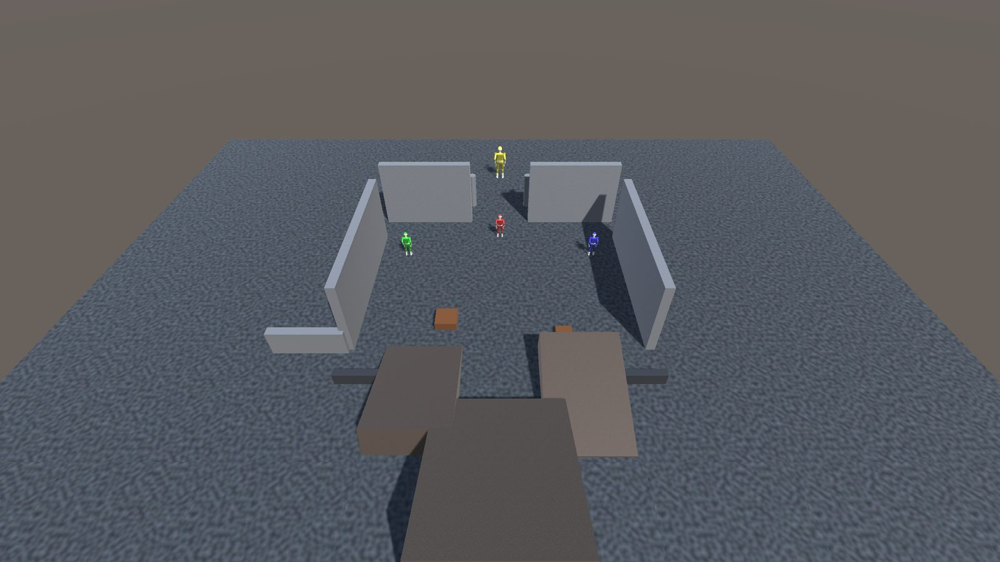 | 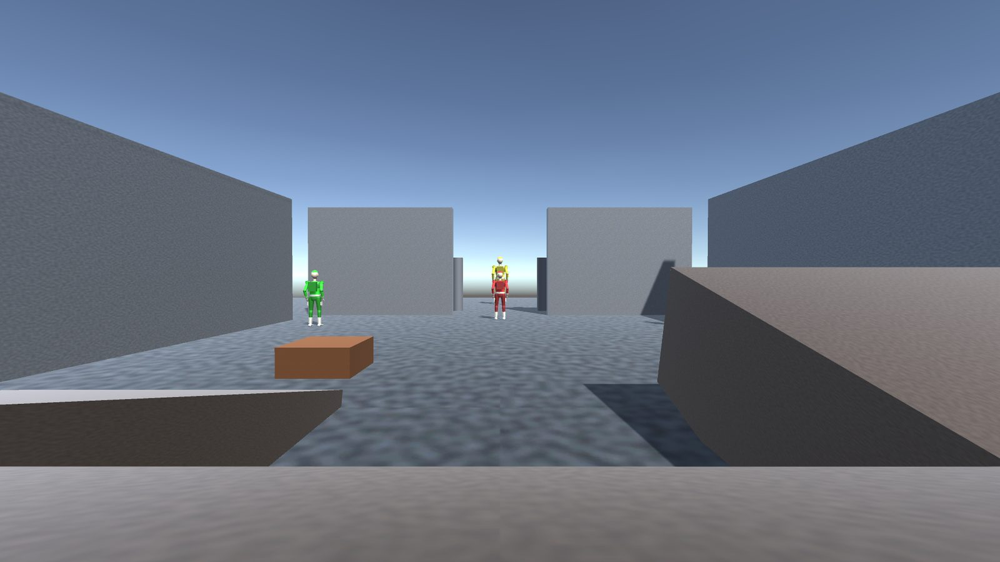 |
|  |  |
|  |  |
|  | 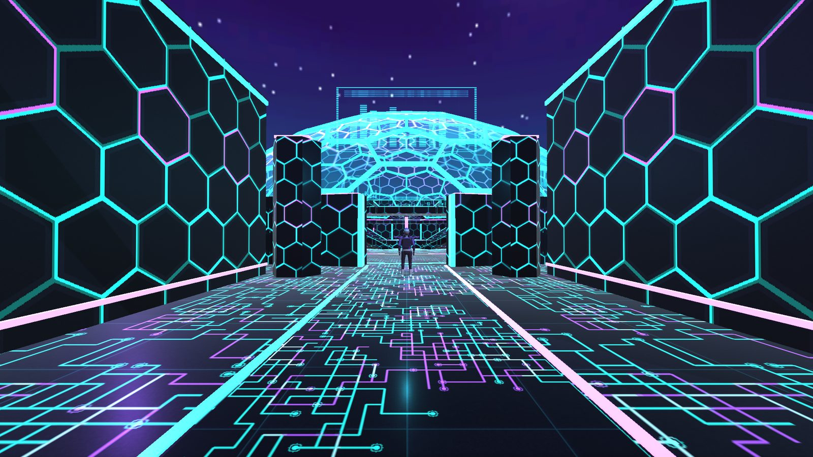 |

### Menus

The loadout menu (`L` or `Esc`), with the map label shown top right. The map selector label is the first image on this page.


### Characters

The Blender-built soldier in engine: a target bot, the player body with a rifle held in both hands, and a side view.

| | | |
| --- | --- | --- |
| 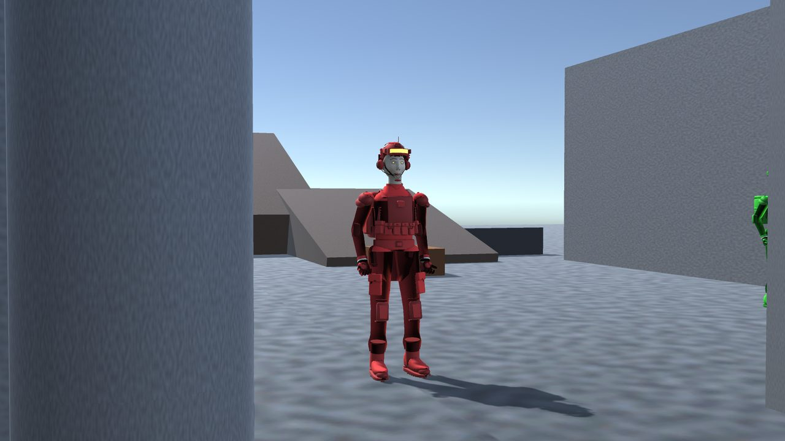 | 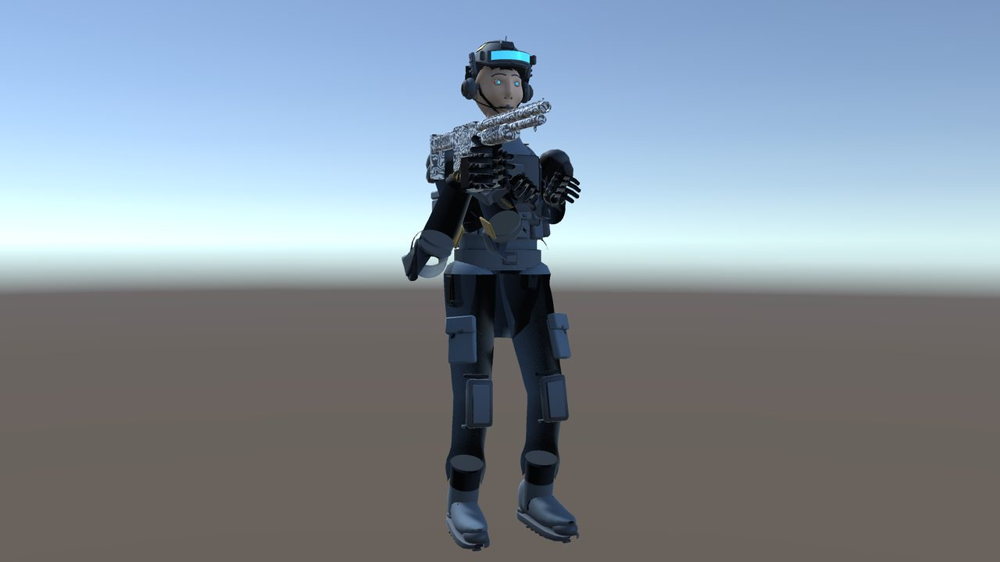 | 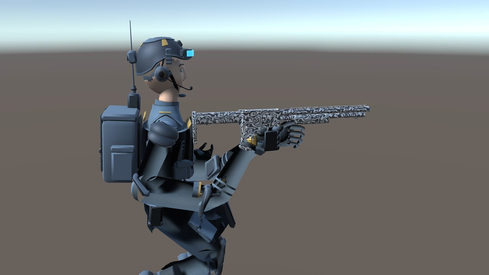 |

### Weapons in engine

Blender-built models in Play Mode, wearing weapon skins.

| | |
| --- | --- |
| 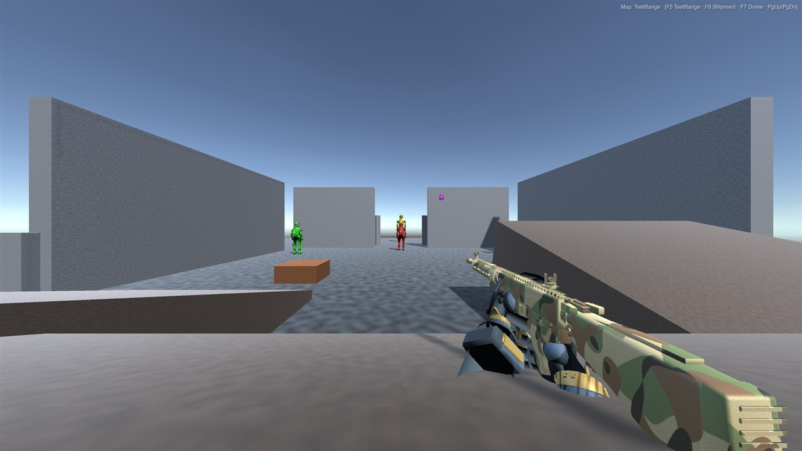 | 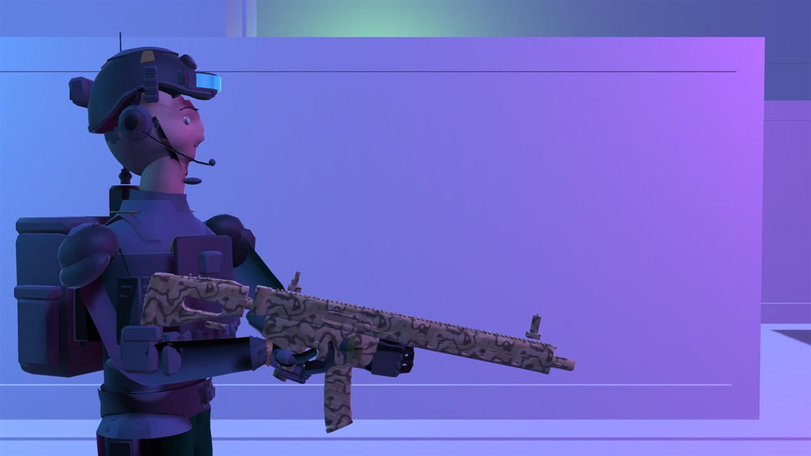 |
| 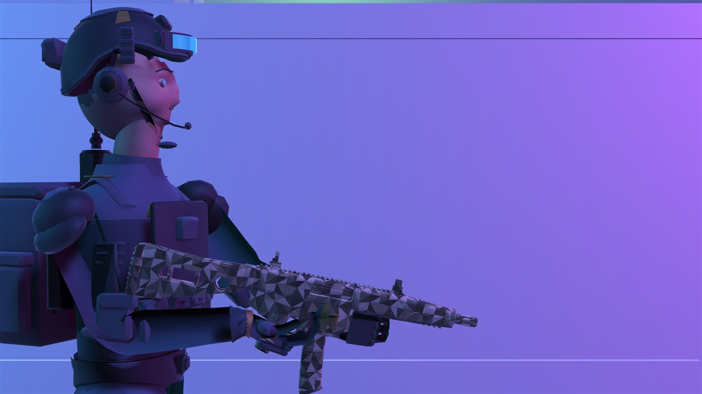 | 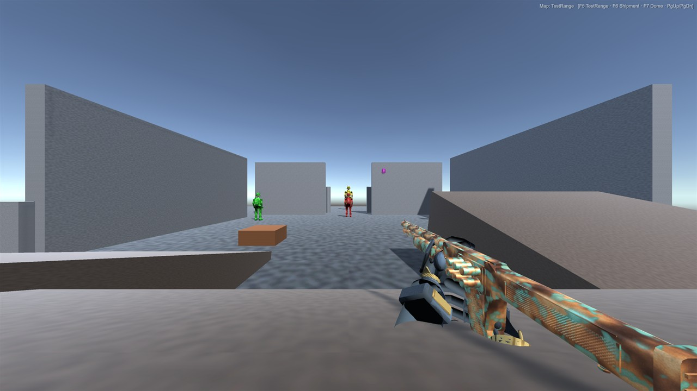 |
| 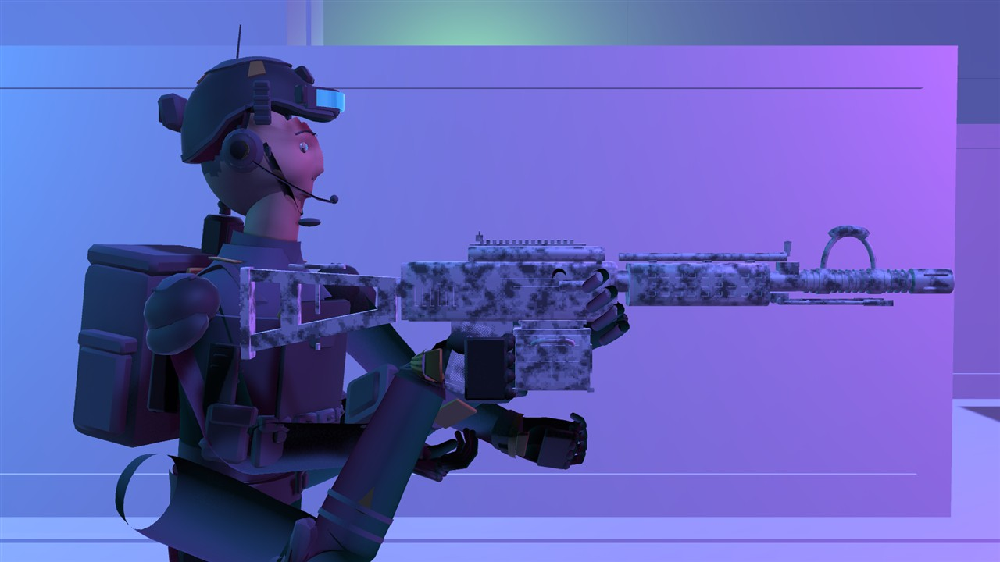 | 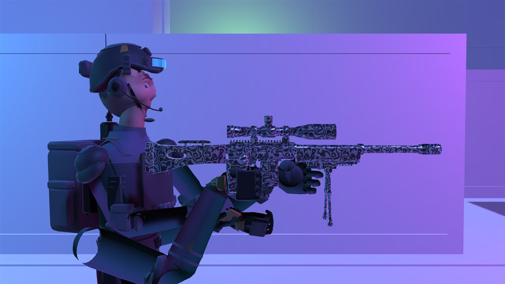 |
|  | 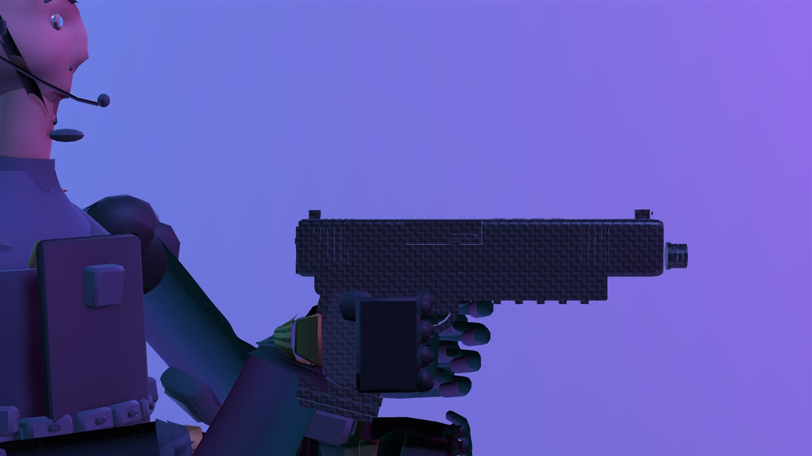 |

The karambit in hand:


### Blender renders

Studio renders written by the generators (M4A1, shotgun, LMG, DMR, bolt sniper, pistol), plus the karambit:

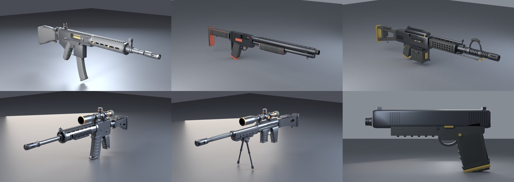


### Skins

Static skin textures (one tile each):


Animated skins (still frames of shaders that animate in game; captured on the earlier primitive gun models):


## Controls

Legacy Input Manager. Source of truth: [`Assets/Scenes/TestRange_Controls.md`](Assets/Scenes/TestRange_Controls.md) and the input code in `Assets/Scripts`.

### Movement and combat

| Action | Keys |
| --- | --- |
| Move | `W` `A` `S` `D` or arrow keys |
| Look | Mouse (cursor is locked in play; `Esc` opens the menu and unlocks it) |
| Jump | `Space` |
| Sprint | `Left Shift` |
| Crouch / slide | `C` or `Left Ctrl` |
| Dolphin dive | `V` while sprinting |
| Fire | Left mouse |
| Aim down sights | Right mouse |
| Reload | `R` |
| Primary / secondary | `1` / `2` |
| Cycle weapons | Mouse wheel |
| Last weapon | `Q` |

### Menus and cosmetics

| Action | Keys |
| --- | --- |
| Loadout menu | `L` (Loadout tab) or `Esc` (pause menu) |
| Class | `F1` Assault, `F2` SMG, `F3` Sniper, `F4` Hybrid |
| Map | `F5` TestRange, `F6` Shipment, `F7` Dome, `PgUp` / `PgDn` to cycle |
| Cycle skin | `[` previous, `]` next (active weapon) |
| Bots | `F8` spawn, `F9` freeze, `F10` difficulty, `F11` debug overlay, `\` or `F12` remove / restore (see `TestRange_Controls.md`) |

### Movement techniques

| Technique | How |
| --- | --- |
| Slide | Sprint (`Shift` + `W`) to roughly 4 m/s or more, then tap `C` / `Ctrl` |
| Slide cancel | Press `Space` while sliding for a horizontal boost jump |
| Bunny hop | Hold `Space` through landings, or tap it within about 0.15 s of landing |
| Dolphin dive | Sprint, then `V` (cooldown about 1.2 s) |
| Air strafe | Hold `A` or `D` in the air while moving; gains come from the air control values in `MovementConfig` |
| Wall bounce | Jump toward a wall at about 6 m/s or faster, then `Space` near it |

Walls need a collider on the `Default` layer to be bounceable. If jumps or slides never register but `WASD` works,
run **Tools > Sync Test Range Player (Character + Classes)**.

## Getting started

1. Install **Unity 6000.6.10f1** (pinned in `ProjectSettings/ProjectVersion.txt`). The project uses the Built-in Render Pipeline and the legacy Input Manager.
2. Open the repository root as a project in Unity Hub and let it import.
3. Open a scene from `Assets/Scenes` (`TestRange`, `Shipment` or `Dome`) and press Play. Maps can also be switched in play with `F5`/`F6`/`F7`.

The `Tools` menu holds the editor utilities:

| Menu item | What it does |
| --- | --- |
| `Tools > Build Test Range`, `Open Test Range Scene`, `Enter Test Range Play Mode` | Rebuild, open or play the TestRange scene |
| `Tools > Maps > Build Shipment` / `Open Shipment` / `Enter Shipment Play Mode` | Regenerate, open or play Shipment |
| `Tools > Maps > Build Dome` / `Open Dome` / `Enter Dome Play Mode` | Regenerate, open or play Dome |
| `Tools > Sync Test Range Player (Character + Classes)` | Re-sync the scene player (character, ground check, camera refs, classes) |
| `Tools > Sync Test Range Weapon Loadout` | Put the weapon prefabs into the TestRange weapon switcher |
| `Tools > Loadout > Rebuild Weapon Catalog` | Regenerate `Assets/Resources/WeaponLoadoutCatalog.asset` after adding weapons, skins or classes |
| `Tools > Skins > Rebuild Weapon Skin Catalog` | Regenerate the skin catalog used by the skin cycler (an EditMode test fails if it is stale) |
| `Tools > Classes > ...` | Create the default class definitions, add the class applier, apply a class to the scene player |
| `Tools > Movement > ...` | Ensure the movement configs, add feedback, apply an archetype config to the scene player |
| `Tools > Build Player Character Prefab` | Regenerate the `PlayerCharacter` prefab |
| `Tools > Run Play Mode Smoke Check` | Quick play-mode sanity run |

Map scenes can also be built headless, for example
`Unity -batchmode -projectPath . -executeMethod ShipmentMapBuilder.BuildBatch -quit`
(Dome: `FpsMaps.Dome.EditorTools.DomeMapBuilder.BuildBatch`).

## Project layout

```
Assets/
  Scenes/          TestRange, Shipment, Dome scenes + TestRange_Controls.md
  Scripts/         Movement, Player, Weapons, Characters (humanoid rig, soldier binder, fallback), Classes, Maps, Targets
  Loadout/         Loadout menu, catalog, selection store, preview rig
  Weapons/         Gun prefabs, materials, Blender-built models (Models/<Gun>/*.fbx), weapon README
  Skins/           Skin shaders, textures, materials, definitions, applier; Tools~ has the Python texture generators
  Classes/         Class definition assets (Assault, SMG, Sniper, Hybrid)
  Configs/         MovementConfig archetypes and per-weapon WeaponConfig assets
  Characters/      PlayerCharacter prefab and notes; Models/ holds the Blender-built soldier and first-person arms
  Maps/            Shipment and Dome scripts, shaders, materials, textures and tests
  Resources/       Weapon loadout catalog and runtime-loaded audio
  Editor/          Map builders, scene sync tools and the Tools menu items
  Tests/           EditMode (Editor) and PlayMode test assemblies
Tools/
  Blender/         Headless Blender 4.2.3 generators for every gun, the karambit and the soldier, plus wire_weapon_models.py
  WeaponGen/       Python generator for the shotgun and LMG primitive prefabs
  Weapons/         Python scripts that mount sniper scopes/bipods and wire imported models into prefabs
docs/
  screenshots/     Images used by this README
```

## Tests

Unity Test Framework (`com.unity.test-framework` 1.4.5). Open **Window > General > Test Runner**
and pick EditMode or PlayMode, or run them headless:

```bash
# EditMode
Unity -batchmode -projectPath . -runTests -testPlatform EditMode -testResults EditModeResults.xml

# PlayMode
Unity -batchmode -projectPath . -runTests -testPlatform PlayMode -testResults PlayModeResults.xml
```

- **EditMode** (`Assets/Tests/Editor`, plus `Assets/Maps/*/Tests`): movement logic, hit detection, class and loadout selection, skin catalog and applier, humanoid body, melee, shotgun and LMG configs, sniper mounting, map catalog, and map layout and geometry contracts.
- **PlayMode** (`Assets/Tests/PlayMode`, plus `Assets/Maps/*/Tests`): TestRange smoke tests, movement techniques such as bunny hop, humanoid bodies in scene, map selector, loadout menu, melee, shotgun and LMG, and the Shipment and Dome scenes (the generated scene has to exist first, so build the map before running its PlayMode tests).

## Blender models and tooling

All guns and the soldier are authored as code and exported into the Unity project, so they can be rebuilt without
opening a DCC tool and nothing is downloaded. Each generator is a headless **Blender 4.2.3** script that writes an `.fbx`
(plus a `.glb` copy) with the muzzle on +Z, metre units and identity rotation, so the prefabs' anchor points line up.

| Where | What |
| --- | --- |
| `Tools/Blender/` | Generators: `build_m4a1.py`, `build_scar.py`, `build_ump.py` (shared `assault_kit.py`), `build_shotgun.py`, `build_lmg.py`, `build_pistol.py` (shared `weapon_lib.py`), `build_bolt_sniper.py`, `build_dmr.py` (shared `gunlib.py`, `gunparts.py`), `build_karambit.py`, and `build_soldier.py` (with `soldier_lib/`). `preview_*_held.py` and `render_gun.py` render studio and held-pose mock images. |
| `Assets/Weapons/Models/<Gun>/` | Exported gun models (`.fbx`, `.glb`, and `.anchors.json` for the snipers). |
| `Assets/Characters/Models/` | `Soldier.fbx` (skinned third-person body), `SoldierArmsFP.fbx` (first-person arms), baked AO maps and soldier materials. |

Run a generator from the repository root, for example:

```bash
blender -b --factory-startup --python Tools/Blender/build_m4a1.py -- \
    --out Assets/Weapons/Models/M4A1 [--renders <dir>]
blender -b --factory-startup --python Tools/Blender/build_soldier.py -- \
    --out Assets/Characters/Models [--renders <dir>] [--no-render]
```

Each script documents its own options at the top of the file, so new generators only need a docstring.
Keep the `.meta` files next to the FBXs when overwriting them: they hold the importer settings, GUIDs and material remaps.

### FBX with a procedural fallback

The original primitive-built parts are never deleted. Small loader components on each prefab (`AssaultWeaponModel`,
`ImportedGunModel`, `WeaponModelLoader`, `KarambitModel`) instantiate the FBX at runtime, validate it, and only then hide
the primitive parts. If the FBX is missing, empty or fails validation, the primitives stay visible and the game keeps
working. The soldier works the same way: `SoldierModelBinder` skins the FBX onto the runtime bones, and
`HumanoidBody.UsesImportedModel` / `ImportFallbackReason` report which body is active.

### Wiring scripts

Plain Python, no Unity or Blender needed, and safe to re-run:

- `python3 Tools/Blender/wire_weapon_models.py` wires the shotgun, LMG and pistol models into their prefabs and writes the `.fbx.meta` files and `Mat_GunAccent`.
  **Re-run it after `Tools/WeaponGen/build_shotgun_lmg.py`**, because that primitive builder regenerates `Shotgun.prefab` and `LMG.prefab` from scratch and drops the wiring.
- `Tools/Weapons/wire_assault_models.py` (M4A1, SCAR, UMP) and `Tools/Weapons/wire_imported_gun_models.py` (bolt sniper, DMR) do the same for those prefabs.
- `python3 Tools/Blender/write_gun_meta.py <model folder> <Gun>` writes the `.meta` files (importer settings, material remaps, pinned GUIDs) for a generated sniper model folder.
- `Tools/Weapons/mount_sniper_parts.py` rebuilds the scope and bipod hierarchy of the primitive sniper prefabs.

Per-model details (triangle counts, object names, material slots, held poses) are in
[`Assets/Weapons/README.md`](Assets/Weapons/README.md) and [`Assets/Characters/Player/README.md`](Assets/Characters/Player/README.md).

## More documentation

- [`Assets/Scenes/TestRange_Controls.md`](Assets/Scenes/TestRange_Controls.md): keys, movement tech, loadout menu
- [`Assets/Weapons/README.md`](Assets/Weapons/README.md): weapon prefabs and Blender models, shotgun and LMG, karambit, sniper mounting
- [`Assets/Skins/README.md`](Assets/Skins/README.md): skin system and how to add skins
- [`Assets/Classes/README.md`](Assets/Classes/README.md): classes and the loadout menu service
- [`Assets/Configs/Movement/README.md`](Assets/Configs/Movement/README.md): movement archetypes and feedback
- [`Assets/Characters/Player/README.md`](Assets/Characters/Player/README.md): Blender-built soldier, procedural fallback, player prefab
- [`Assets/Maps/Shipment/README.md`](Assets/Maps/Shipment/README.md), [`Assets/Maps/Dome/README.md`](Assets/Maps/Dome/README.md): map layouts and build steps
